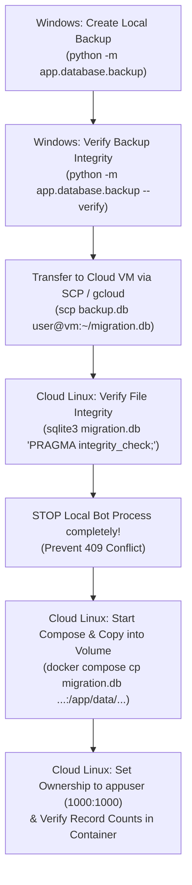

# BirthdayMate — Complete Production Deployment & Operations Runbook

This guide is a complete, step-by-step runbook for deploying, migrating, and maintaining **BirthdayMate** on a Linux x86-64 server, specifically tailored for **Google Cloud Compute Engine's Always Free `e2-micro` VM**.

---

## Table of Contents
1. [Architecture & Component Overview](#1-architecture--component-overview)
2. [Google Cloud Platform (GCP) Free Tier Eligibility & Costs](#2-google-cloud-platform-gcp-free-tier-eligibility--costs)
3. [Creating the VM on Google Cloud](#3-creating-the-vm-on-google-cloud)
4. [Server Preparation & Docker Installation](#4-server-preparation--docker-installation)
5. [Deploying the Application Code](#5-deploying-the-application-code)
6. [Environment Variables & Secret Configuration](#6-environment-variables--secret-configuration)
7. [Database Migration (Moving Local Database to Cloud)](#7-database-migration-moving-local-database-to-cloud)
8. [Starting, Stopping & Monitoring the Bot](#8-starting-stopping--monitoring-the-bot)
9. [Automated Daily Backups, Retention & Verification](#9-automated-daily-backups-retention--verification)
10. [Disaster Recovery & Offsite Backups](#10-disaster-recovery--offsite-backups)
11. [Single-Instance Polling Rules & Conflict Prevention](#11-single-instance-polling-rules--conflict-prevention)
12. [Production Verification Checklist](#12-production-verification-checklist)

---

## 1. Architecture & Component Overview

- **Host Environment**: Linux x86-64 (Ubuntu 24.04 LTS or Debian 12).
- **Runtime**: Python 3.12 (Debian Bookworm slim container, non-root `appuser` UID 1000).
- **Communication Model**: Telegram Bot API via **long-polling** (`getUpdates`).
  > [!NOTE]
  > Long-polling requires **only outbound HTTPS** to `api.telegram.org` and `generativelanguage.googleapis.com`. **No open inbound firewall ports, public domain, or SSL certificates are required.**
- **Storage**:
  - `birthdaymate_data` volume -> `/app/data/birthday_mmenn.db` (persistent SQLite database).
  - `birthdaymate_backups` volume -> `/app/backups/` (timestamped database backups).
- **Process Management**: Docker Compose with `init: true` and `restart: unless-stopped`.
- **Health Check**: Native internal probe (`python -m app.healthcheck`) evaluating process, database, and storage health every 60s.

---

## 2. Google Cloud Platform (GCP) Free Tier Eligibility & Costs

> [!WARNING]
> While Google Cloud provides an Always Free tier, **$0/month is not unconditionally guaranteed**. You must observe specific restrictions to avoid unexpected charges.

### Free Tier Conditions to Check:
1. **Verified Billing Account**: Google Cloud requires a valid credit/debit card to activate your account. You will not be charged if you stay within free tier limits, but verification is required.
2. **Eligible Machine Type**: Only **`e2-micro`** (2 vCPUs burstable, 1 GB RAM) qualifies for Always Free compute.
3. **Eligible Regions**: The VM must be located in one of these US regions:
   - `us-central1` (Iowa)
   - `us-east1` (South Carolina)
   - `us-west1` (Oregon)
4. **Disk Storage**: Free tier includes **up to 30 GB of Standard Persistent Disk** (`pd-standard`) per month. Do *not* choose Balanced (`pd-balanced`) or SSD (`pd-ssd`), as they may incur small monthly fees.
5. **Network Egress**: Free tier includes **1 GB of network egress per month** from North America to all destinations (excluding China and Australia). Long-polling and short text messages consume ~100–300 MB/month, well within this limit.
6. **Static vs Ephemeral External IP**: In-use ephemeral external IP addresses on a running VM are free. **Do not reserve a static external IP**, as unused static IPs incur hourly charges.

---

## 3. Creating the VM on Google Cloud

You can create the VM using the Google Cloud Console (web browser) or the `gcloud` CLI.

### Option A: Using Google Cloud Web Console
1. Open [Google Cloud Console](https://console.cloud.google.com/) and select your project.
2. Go to **Compute Engine** -> **VM instances** -> click **Create Instance**.
3. Configure the following settings:
   - **Name**: `birthdaymate-vm`
   - **Region**: `us-central1` (Iowa), `us-east1` (South Carolina), or `us-west1` (Oregon).
   - **Zone**: Any zone in the selected region (e.g. `us-central1-a`).
   - **Machine Configuration**: Series **E2**, Machine type **`e2-micro`** (2 vCPU, 1 GB memory).
   - **Boot disk**: Click *Change*:
     - Operating System: **Ubuntu**
     - Version: **Ubuntu 24.04 LTS (x86/64)**
     - Boot disk type: **Standard persistent disk**
     - Size: **20 GB** or **25 GB** (must be <= 30 GB).
     - Click *Select*.
   - **Firewall**: Leave "Allow HTTP traffic" and "Allow HTTPS traffic" **unchecked** (inbound ports are not needed).
4. Click **Create**.

---

## 4. Server Preparation & Docker Installation

Connect to your VM via SSH:
- In Google Cloud Console, click the **SSH** button next to your VM name, or use `gcloud compute ssh birthdaymate-vm`.

Once inside the Linux SSH terminal, execute the following commands:

### Step 4.1: Update System Packages
```bash
# In Linux SSH Terminal:
sudo apt-get update && sudo apt-get upgrade -y
sudo apt-get install -y curl git sqlite3
```

### Step 4.2: Install Docker Engine & Docker Compose
```bash
# In Linux SSH Terminal:
curl -fsSL https://get.docker.com -o get-docker.sh
sudo sh get-docker.sh
sudo usermod -aG docker $USER
```
*Log out and log back in, or run `newgrp docker`, so your user group takes effect:*
```bash
newgrp docker
docker --version
docker compose version
```

---

## 5. Deploying the Application Code

### Step 5.1: Create Project Directory & Clone Code
```bash
# In Linux SSH Terminal:
sudo mkdir -p /opt/birthdaymate
sudo chown $USER:$USER /opt/birthdaymate
cd /opt/birthdaymate

# Clone your repository (or copy files via SCP):
git clone <YOUR_GIT_REPOSITORY_URL> .
```

---

## 6. Environment Variables & Secret Configuration

### Step 6.1: Create `.env` on the Cloud Server
```bash
# In Linux SSH Terminal:
cd /opt/birthdaymate
cp .env.example .env
nano .env
```

### Step 6.2: Set Your Production Values
```env
# Telegram Bot Token from @BotFather
TELEGRAM_BOT_TOKEN=your_production_bot_token_here

# Google Gemini API Key
AI_API_KEY=your_gemini_api_key_here

# (Optional) Configured Models
GEMINI_MODEL=gemini-3.8-flash
GEMINI_FALLBACK_MODEL=gemini-3-flash-preview

# Application Settings
DEFAULT_TIMEZONE=Asia/Phnom_Penh
LOG_LEVEL=INFO
```
Save with `Ctrl+O`, `Enter`, and exit with `Ctrl+X`.

> [!IMPORTANT]
> - Never commit `.env` to Git.
> - On the cloud server, restrict file permissions so only your user can read it:
>   `chmod 600 /opt/birthdaymate/.env`

---

## 7. Database Migration (Moving Local Database to Cloud)

If you have existing users and friends in your local Windows database (`birthday_mmenn.db`), follow this safe, non-destructive migration procedure:



### Step 7.1 (On Local Windows Machine): Create & Verify Backup
Open PowerShell in `D:\PROJECT\BDTelegramBot`:
```powershell
# In Windows PowerShell:
.\.venv\Scripts\python.exe -m app.database.backup --source birthday_mmenn.db --dest backups
.\.venv\Scripts\python.exe -m app.database.backup --dest backups --list
```
Identify the latest backup created in `backups/`, e.g. `birthday_mmenn_backup_20261030_120000.db`.

### Step 7.2 (On Local Windows Machine): Upload Backup to VM
Using standard `scp` (replace `USER` and `VM_EXTERNAL_IP` with your actual GCP VM details):
```powershell
# In Windows PowerShell:
scp .\backups\birthday_mmenn_backup_20261030_120000.db USER@VM_EXTERNAL_IP:~/migration_birthday.db
```
*(Or use `gcloud compute scp .\backups\birthday_mmenn_backup_20261030_120000.db birthdaymate-vm:~/migration_birthday.db --zone=YOUR_ZONE`)*

### Step 7.3 (On Cloud Linux VM): Verify File Integrity
In your Linux SSH terminal:
```bash
# In Linux SSH Terminal:
sqlite3 ~/migration_birthday.db "PRAGMA integrity_check;"
# Must print: ok
```

### Step 7.4: CRITICAL SAFETY CHECK — Stop Local Bot
> [!CAUTION]
> **STOP your local Windows bot process right now.**
> If your local bot and the cloud bot run at the same time using the same token, Telegram will crash polling with `409 Conflict`.

### Step 7.5 (On Cloud Linux VM): Copy Database into Persistent Volume
```bash
# In Linux SSH Terminal:
cd /opt/birthdaymate

# 1. Start the container once to initialize named volumes
docker compose up -d --build

# 2. Copy the verified database into the persistent volume directory
docker compose cp ~/migration_birthday.db birthdaymate_bot:/app/data/birthday_mmenn.db

# 3. Ensure the non-root appuser (UID 1000) owns the database file
docker compose exec birthdaymate chown appuser:appgroup /app/data/birthday_mmenn.db
docker compose exec birthdaymate chmod 644 /app/data/birthday_mmenn.db

# 4. Restart container to pick up the transferred database
docker compose restart birthdaymate

# 5. Clean up temporary upload file
rm ~/migration_birthday.db
```

### Step 7.6: Verify Database Contents Inside Container
```bash
# In Linux SSH Terminal:
docker compose exec birthdaymate python -c "from app.database.database import get_session; from app.database.models.friend import Friend; session = next(get_session()); print('Transferred friends count:', session.query(Friend).count())"
```

---

## 8. Starting, Stopping & Monitoring the Bot

### Build & Start:
```bash
cd /opt/birthdaymate
docker compose up -d
```

### Check Container Status & Health:
```bash
docker compose ps
```
The status will display:
```text
NAME               IMAGE                 STATUS                   PORTS
birthdaymate_bot   birthdaymate:latest   Up 2 minutes (healthy)   
```

### View Live Logs:
```bash
docker compose logs -f birthdaymate
```

### Stop the Bot Gracefully:
```bash
docker compose stop
```

### Restart the Bot:
```bash
docker compose restart birthdaymate
```

---

## 9. Automated Daily Backups, Retention & Verification

BirthdayMate includes a native, non-locking SQLite backup utility that operates safely on live databases.

### Step 9.1: Set Up Automated Host Cron Job
On the Linux VM, open the crontab editor:
```bash
# In Linux SSH Terminal:
crontab -e
```
Add the following line to run an automated verified backup every day at 02:00 AM:
```cron
0 2 * * * docker compose -f /opt/birthdaymate/docker-compose.yml exec -T birthdaymate python -m app.database.backup --keep 7 >> /var/log/birthdaymate_backup.log 2>&1
```

### Step 9.2: Inspect Backup History & Health
To list all backups and verify their SQLite integrity:
```bash
# In Linux SSH Terminal:
docker compose exec birthdaymate python -m app.database.backup --list
```
*Example Output:*
```text
Found 3 backup(s):
 - birthday_mmenn_backup_20261030_020000.db (68.0 KB, modified: 2026-10-30 02:00:00) [OK]
 - birthday_mmenn_backup_20261029_020000.db (68.0 KB, modified: 2026-10-29 02:00:00) [OK]
```

To run a deep integrity verification across all backups:
```bash
docker compose exec birthdaymate python -m app.database.backup --verify ALL
```

---

## 10. Disaster Recovery & Offsite Backups

> [!IMPORTANT]
> **Never keep backups solely on the VM.** If the VM disk is corrupted or accidentally deleted, all local backups will be lost.

### Step 10.1: Periodically Download Backups Offsite (To Local PC)
From your local Windows computer:
```powershell
# In Windows PowerShell:
# 1. On VM, extract backup to home directory:
ssh USER@VM_EXTERNAL_IP "docker compose -f /opt/birthdaymate/docker-compose.yml cp birthdaymate_bot:/app/backups ~/vm_backups_temp"

# 2. Download to your local PC:
scp -r USER@VM_EXTERNAL_IP:~/vm_backups_temp .\offsite_backups_$(Get-Date -Format 'yyyyMMdd')
```

### Step 10.2: Safe Database Restoration Procedure
If the database ever needs to be restored from a backup:
```bash
# In Linux SSH Terminal:
cd /opt/birthdaymate

# 1. Stop the bot
docker compose stop birthdaymate

# 2. Restore from backup (verifies PRAGMA integrity_check before restoring)
docker compose run --rm birthdaymate python -m app.database.backup --restore /app/backups/birthday_mmenn_backup_YYYYMMDD_HHMMSS.db --to /app/data/birthday_mmenn.db

# 3. Start the bot
docker compose start birthdaymate

# 4. Check health
docker compose ps
docker compose logs --tail=20 birthdaymate
```

---

## 11. Single-Instance Polling Rules & Conflict Prevention

Telegram Bot API enforces that **only one client instance can poll for updates with a given bot token at a time**.

### What Happens During Conflicts:
If two instances poll simultaneously:
```text
telegram.error.Conflict: Conflict: terminated by other getUpdates request; make sure that only one bot instance is running
```
Both instances will reconnect repeatedly, dropping messages and creating duplicate notifications.

### How to Prevent Conflicts:
1. `container_name: birthdaymate_bot` prevents launching multiple containers via `docker compose --scale`.
2. **Never** run `python -m app.main` on your local PC using the production bot token.
3. For local development, create a separate test bot via `@BotFather` and use `.env.test`.

---

## 12. Production Verification Checklist

Run through this complete checklist after launching BirthdayMate:

- [ ] **1. Container Status**: `docker compose ps` reports `Up` and `(healthy)`.
- [ ] **2. Single Instance**: Only one container named `birthdaymate_bot` is running (`docker ps`).
- [ ] **3. No Telegram Conflict**: `docker compose logs` shows polling started without `409 Conflict`.
- [ ] **4. Bot Responds**: Send `/start` in Telegram. Main menu keyboard displays.
- [ ] **5. Friend Management**:
  - [ ] Tap **"👥 My Friends"** — list renders with pagination.
  - [ ] Add a new friend via **"➕ Add Friend"** conversation.
  - [ ] View friend profile and edit nickname/relationship.
- [ ] **6. Upcoming Birthdays**: Tap **"🎂 Upcoming Birthdays"** — verifies sorted upcoming dates.
- [ ] **7. Settings**: Open `/settings`, toggle reminder hour or advance days. Confirms instant response without hung spinners.
- [ ] **8. AI Wish Generation**:
  - [ ] Tap **"✨ Create Wish"** -> select friend -> choose tone -> generate wish.
  - [ ] Verify generated wish appears.
  - [ ] Test **"✏️ Edit Wish"** and submit revised text.
  - [ ] Test **"📋 Copy Wish"** and history archiving.
- [ ] **9. Database Persistence**: Run `docker compose restart birthdaymate`. Verify all friends and wishes remain accessible.
- [ ] **10. Backup Execution**: Run `docker compose exec birthdaymate python -m app.database.backup`. Verify `✅ Database backup created & verified successfully`.
- [ ] **11. Log Privacy**: Review `docker compose logs --tail=50`. Verify no API keys, tokens, or private conversation text appear.
